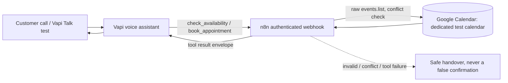

# AI Salon Voice Receptionist

A working AI phone receptionist for a demo salon: a **Vapi** voice assistant answers the call, an **authenticated n8n webhook** validates every tool request, and **Google Calendar** stays the system of record for bookings. Built spec-first — the booking contract is written down before any service is wired, all model arguments are treated as untrusted input, and the assistant is never allowed to claim a booking it did not actually create.

**Status: Stage 1 complete and verified end-to-end.** A live voice call was booked into a dedicated test calendar through the production webhook, including the three paths that matter most:

| Path | Result |
| --- | --- |
| Free slot + `book_appointment` | `{"booked": true, "bookingReference": "<event id>"}` — exactly one event in the test calendar |
| Same slot again | `{"booked": false, "reason": "slot_unavailable"}` — no second event created |
| `check_availability` on a busy slot | `{"available": false, "reason": "slot_unavailable"}` with a valid alternative slot |

Related project: [ai-complaint-orchestrator](https://github.com/svempeny-gpsw/ai-complaint-orchestrator) — same engineering approach (deterministic validation before actions, idempotency, failure isolation, secret-free exports) applied to a complaint-routing system.

## Architecture



Design rules that drive every line of the workflow (`specs/booking-contract.md` is the source of truth):

- **The model is untrusted.** Service names must match a configured allow-list, times must be ISO-8601 with an explicit UTC offset plus an IANA `timeZone`, phones must be E.164, and the end time is always computed from the configured service duration — never accepted from the model.
- **Check again before creating.** `book_appointment` re-runs validation and a Calendar conflict check immediately before event creation.
- **Structured outcomes, safe errors.** Business results (`slot_unavailable`, `invalid_request`) are returned as structured `result` JSON; the `error` field is reserved for technical failures with a safe message. Success is claimed only after Calendar returns an event ID.
- **One result per tool call.** Every incoming `toolCallId` gets exactly one matching response entry in Vapi's envelope.
- **Secrets never live in this repository.** Credential references are configured in the running n8n instance; exports, configs, and docs contain placeholders only.

## What's in the repository

```text
specs/booking-contract.md        # trust boundaries, schemas, result semantics, acceptance cases
n8n/workflows/salon-receptionist.json  # importable, secret-free n8n 2.x workflow (POST + header auth)
config/salon.example.json        # fictional demo salon: services, hours, prices, handover
config/vapi-assistant.example.md # assistant system prompt (service mapping, phone normalization)
config/vapi-tools.*.example.json # Vapi function-tool definitions for both Vapi tools
compose.yaml                     # n8n 2.44.4 in Docker, localhost-only by default
INSTALL.md                       # full local setup: Docker, credentials, tunneling for Vapi
```

Stage 1 keeps everything deterministic and stateless at the webhook: no database, no sidecar service — Google Calendar is the only booking system of record. Stage 2 will add durable idempotency and a concurrency-safe slot reservation (the known race-window fix).

## Quick start

1. **Start the stack**
   ```sh
   docker compose up -d
   ```
   then open <http://localhost:5678>, finish n8n owner setup, and complete the steps in [INSTALL.md](INSTALL.md) (Google Calendar OAuth credential, Header Auth credential, test calendar).
2. **Import the workflow** — in n8n, import [`n8n/workflows/salon-receptionist.json`](n8n/workflows/salon-receptionist.json), select your Header Auth + Google Calendar credentials, and replace `REPLACE_WITH_TEST_CALENDAR_ID`; then publish it so the production webhook is live.
3. **Update the Vapi side** — create two function tools from the definitions in [`config/`](config/), point their server URL at your n8n webhook (Vapi cannot reach `localhost`; use an HTTPS tunnel as described in [INSTALL.md](INSTALL.md)) and attach a secret header credential.
4. **Configure the assistant** — set the system prompt from [`config/vapi-assistant.example.md`](config/vapi-assistant.example.md) and the salon policy from [`config/salon.example.json`](config/salon.example.json).
5. **Test** — start with Vapi's browser Talk session against a *test* calendar, then verify each case in the acceptance table of the booking contract: success, conflict, invalid service/time/phone, and tool failure (which must apologize and hand over, never fake success).

## Known limitations (deliberate for Stage 1)

- "Check then re-check then create" still has a race window between the conflict check and event creation — fine for a demo, not a production guarantee. Stage 2 adds durable idempotency and concurrency-safe reservations.
- Quick Cloudflare tunnels make local testing easy but change hostname on every restart and are not production endpoints.
- Reschedule and cancellation are intentionally out of scope; the assistant hands those to staff rather than implying it changed an event.

## Useful references

- [Vapi function tools](https://docs.vapi.ai/tools/custom-tools) · [server URLs](https://docs.vapi.ai/server-url/setting-server-urls) · [server authentication](https://docs.vapi.ai/server-url/server-authentication)
- [n8n Webhook node](https://docs.n8n.io/integrations/builtin/core-nodes/n8n-nodes-base.webhook) · [Respond to Webhook](https://docs.n8n.io/integrations/builtin/core-nodes/n8n-nodes-base.respondtowebhook) · [Google Calendar operations](https://docs.n8n.io/integrations/builtin/app-nodes/n8n-nodes-base.googlecalendar/calendar-operations)

## License

[MIT](LICENSE)
